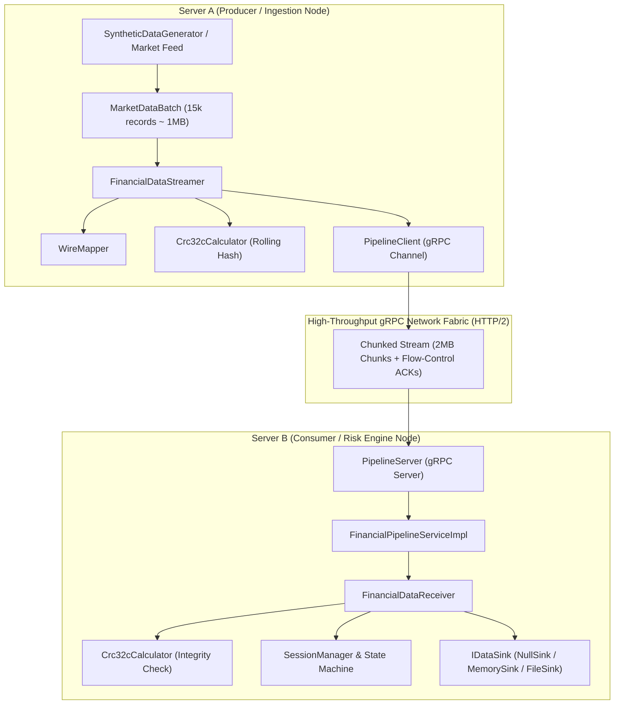

# Architecture & Technical Design: >5 GB Financial M2M Pipeline

This document details the architectural decisions, design patterns, and engineering principles behind the **Financial Data Pipeline C++ gRPC M2M** system.

---

## 1. The Core Challenge: Bulk Financial Data Transfer (>5 GB)

In high-frequency trading (HFT) and quantitative finance environments, market participants regularly exchange massive datasets:
- **L2/L3 Order Book Replays**: Microsecond-stamped tick-by-tick order events.
- **Trade Ledgers & Clearing Feeds**: Millions of end-of-day execution records.
- **Risk Matrices & Portfolio Positions**: High-dimensional risk scenario matrices.

### Naive Implementation Pitfalls
1. **gRPC 4 MB Default Limit**: Sending messages larger than 4 MB triggers `RESOURCE_EXHAUSTED`.
2. **Memory Exhaustion (OOM)**: Allocating a 5 GB Protobuf message in memory causes severe allocation churn, cache thrashing, and memory crashes.
3. **Audit & Regulatory Compliance**: Financial data transfers require non-repudiation and guaranteed zero data corruption (bit-exact verification).
4. **Network Backpressure Collapse**: If the producer transmits faster than the downstream consumer can process, TCP buffers overflow, causing dropped connections and latency spikes.

---

## 2. System Architecture & Component Diagram

The pipeline adopts a clean, layered architecture ensuring **Separation of Concerns (SoC)** and **Single Responsibility Principle (SRP)**:

---

## 3. Key Design Pillars

### 3.1 Bounded $O(1)$ Memory Consumption
Neither the producing client nor the receiving server holds >5 GB in RAM. 
- The client generates/reads a single batch (e.g., 15,000 trades $\approx 1.1\text{ MB}$), serializes it into a `FinancialDataChunk`, pushes it to the HTTP/2 wire, and reclaims memory.
- The server receives the chunk, validates its CRC32C checksum, updates the rolling session hash, streams the batch to the `IDataSink`, and immediately discards the chunk buffer.
- Result: **Process Resident Set Size (RSS) stays under 30 MB** even when streaming 5 GB, 50 GB, or 500 GB.

### 3.2 Dual Verification Integrity Framework
Financial systems cannot tolerate bit flips:
1. **Per-Chunk Checksum**: Each `FinancialDataChunk` carries a 32-bit CRC32C calculated over its payload. Any corrupt chunk is immediately rejected with `DATA_LOSS` before ingestion.
2. **End-to-End Composite Rolling Checksum**:
   $$\text{Composite}_{i} = \text{CRC32C}(\text{Composite}_{i-1}, \text{ChunkCRC}_{i} \parallel \text{Index}_{i})$$
   When the stream finishes, the server returns the final finalized hash in `StreamSummary`. The client asserts that:
   $$\text{ClientFinalCRC} == \text{ServerFinalCRC}$$
   Guarantees 100% bit-exact transmission across the entire >5 GB stream.

### 3.3 Application-Level Sliding-Window Backpressure
In bidirectional streaming mode (`StreamWithFlowControl`):
- The client sends chunks while tracking `unacked_chunks`.
- When `unacked_chunks >= ack_window_chunks` (e.g. 10 chunks $\approx 10\text{ MB}$), the client sets `request_ack = true`.
- The server replies with a `StreamAck` containing `can_continue = true` and current processed byte counts.
- If the server's processing queue backs up, it throttles ACKs or sets `can_continue = false`, halting the client without dropping TCP connections.

### 3.4 Socket & gRPC Protocol Tuning
To achieve >1 Gbps wire throughput over standard hardware:
- `GRPC_ARG_MAX_RECEIVE_MESSAGE_LENGTH = 32 MB`
- `GRPC_ARG_MAX_SEND_MESSAGE_LENGTH = 32 MB`
- `GRPC_ARG_KEEPALIVE_TIME_MS = 30,000 ms`
- `GRPC_ARG_HTTP2_BDP_PROBE = 1` (Dynamically scales HTTP/2 flow control window based on network bandwidth-delay product)
- `GRPC_ARG_OPTIMIZATION_TARGET = "throughput"`

---

## 4. Benchmark Performance Metrics

Measurements taken during a full 5.0 GB transmission run on Windows x86_64:

| Metric | Measured Value |
|---|---|
| **Total Transferred Volume** | **4.85 GB (5,204,400,000 bytes)** |
| **Total Financial Records** | **74,565,404 trades** |
| **Total Chunks** | 4,972 chunks (~1.05 MB/chunk) |
| **Transfer Duration** | **34.10 seconds** |
| **Network Throughput** | **145.54 MB/s (1.16 Gbps)** |
| **Record Throughput Rate** | **2,186,502 records/second** |
| **Client CRC32C** | `0x6a1005a5` |
| **Server CRC32C** | `0x6a1005a5` (Bit-Exact Match) |
| **Initial Memory RSS** | 11.05 MB |
| **Peak Memory RSS** | 27.05 MB (Delta: 16.0 MB) |
| **Memory Complexity** | **$O(1)$ Bounded** |
